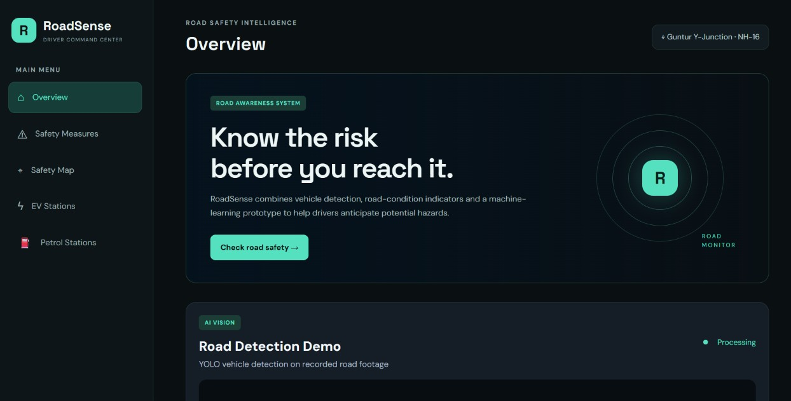

# 🚦 RoadSense — AI-Powered Road Safety Monitoring

RoadSense is a road safety prototype designed to identify potential road risks using computer vision, machine learning, and road-condition indicators. It combines video-based vehicle analysis with risk assessment and a dashboard to help users understand potentially hazardous road conditions.

## ✨ Features

- **Road Risk Assessment:** Estimates road risk using available road and traffic indicators.
- **Video Analysis:** Processes video for vehicle detection and road-scene analysis.
- **Computer Vision:** Uses OpenCV and related detection tools for visual processing.
- **Machine Learning:** Uses an XGBoost-based model for risk prediction.
- **Interactive Dashboard:** Displays road safety information and risk indicators.
- **Report History:** Supports viewing saved reports.
- **AWS Report Storage:** Includes AWS Lambda and Amazon S3 integration for report storage.

## 🛠️ Technology Stack

- **Frontend:** HTML, CSS, JavaScript
- **Backend:** Python, FastAPI, Uvicorn
- **Computer Vision:** OpenCV, Ultralytics
- **Machine Learning:** XGBoost
- **Data Processing:** NumPy, pandas
- **Cloud Integration:** AWS Lambda, Amazon S3
- **Version Control:** Git and GitHub

## 📁 Project Structure

```text
RoadSense/
├── backend/
│   ├── app.py
│   ├── report_history.py
│   └── video_stream.py
├── frontend/
│   ├── index.html
│   ├── script.js
│   └── style.css
├── dashboard.png.jpg
├── lambda_app.py
├── lambda_handler.py
├── requirements.txt
├── requirements-lambda.txt
└── README.md
```

*Note: This structure highlights the main files; other project files and model assets may also be present.*

## 🚀 Getting Started

### Prerequisites

Install Python and Git on your computer. Use Windows PowerShell for the commands below.

### 1. Clone the Repository

```powershell
git clone https://github.com/yasaswinibaliboyina-crypto/RoadSense.git
cd RoadSense
```

If you already have the repository, navigate to your existing project folder instead:

```powershell
cd C:\Users\balib\OneDrive\Desktop\RoadSense
```

### 2. Set Up the Python Environment

Create a virtual environment:

```powershell
py -m venv .venv
```

Activate it:

```powershell
.\.venv\Scripts\Activate.ps1
```

Install the project dependencies:

```powershell
py -m pip install -r requirements.txt
```

If PowerShell blocks activation, run the following in that terminal and try activating again:

```powershell
Set-ExecutionPolicy -Scope Process -ExecutionPolicy Bypass
.\.venv\Scripts\Activate.ps1
```

### 3. Start the Backend

From the **RoadSense project root**, run:

```powershell
py -m uvicorn backend.app:app --reload
```

Keep this terminal open while using the application.

When the server starts successfully, open:

- **Backend API:** http://127.0.0.1:8000
- **Interactive API documentation:** http://127.0.0.1:8000/docs

If Uvicorn is not installed in the active Python environment, install it using:

```powershell
py -m pip install uvicorn
```

Then retry the backend command.

### 4. Start the Frontend

Open a **second PowerShell terminal** and navigate to the project root:

```powershell
cd C:\Users\balib\OneDrive\Desktop\RoadSense
```

Start a local HTTP server:

```powershell
py -m http.server 5500
```

Keep this terminal open. Open the frontend in your browser:

http://127.0.0.1:5500/frontend/index.html

Make sure the backend is also running. Frontend features that call the API depend on the backend being available and correctly configured.

### 5. Running Video Analysis

Use the video-analysis functionality provided in the dashboard. Ensure the required model files, Python dependencies, and video inputs are available in the locations expected by the project.

## 📸 Screenshots and Demo

### RoadSense Dashboard



### Video Detection Demo


Replace `video_demo.png` with the actual filename of the video screenshot committed to this repository.

## ☁️ AWS Integration

RoadSense includes AWS Lambda and Amazon S3 integration for storing reports.

The AWS-backed functionality requires the relevant Lambda configuration, S3 permissions, and endpoint settings to be available. The local backend and frontend can be run using the development instructions above; AWS functionality depends on its own configuration.

## 🔍 Prototype Scope and Limitations

RoadSense is a prototype intended to demonstrate the application of computer vision and machine learning to road safety monitoring. Risk predictions are estimates based on the available inputs and model. They should not be treated as verified real-world safety assessments or a substitute for official road safety systems.

Local development URLs such as `127.0.0.1` are accessible only from the computer running the application. They are not public deployment links.

## 👩‍💻 Repository

GitHub: https://github.com/yasaswinibaliboyina-crypto/RoadSense

## 📄 License

Add the applicable license here if the project has one.
